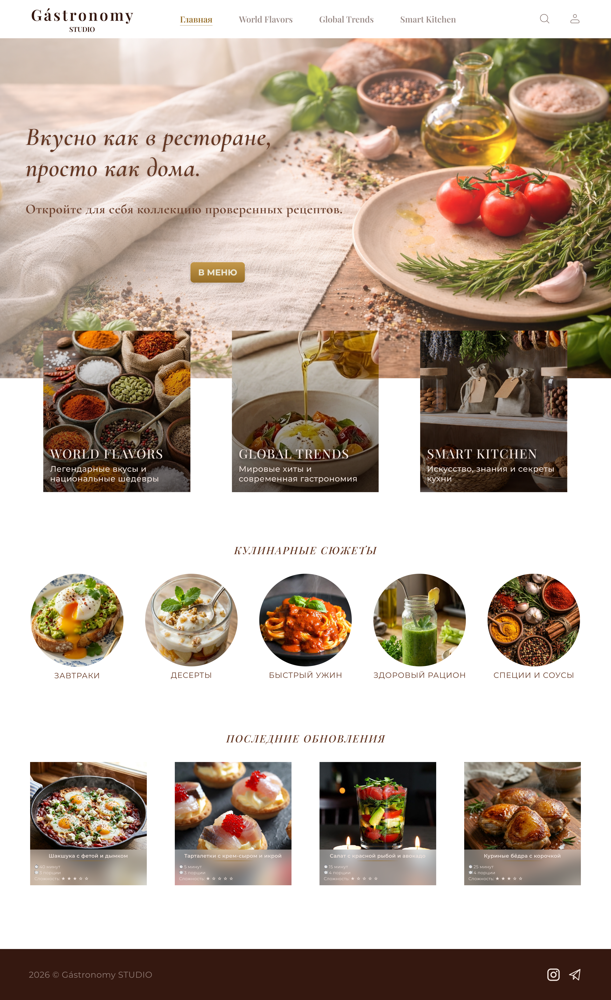
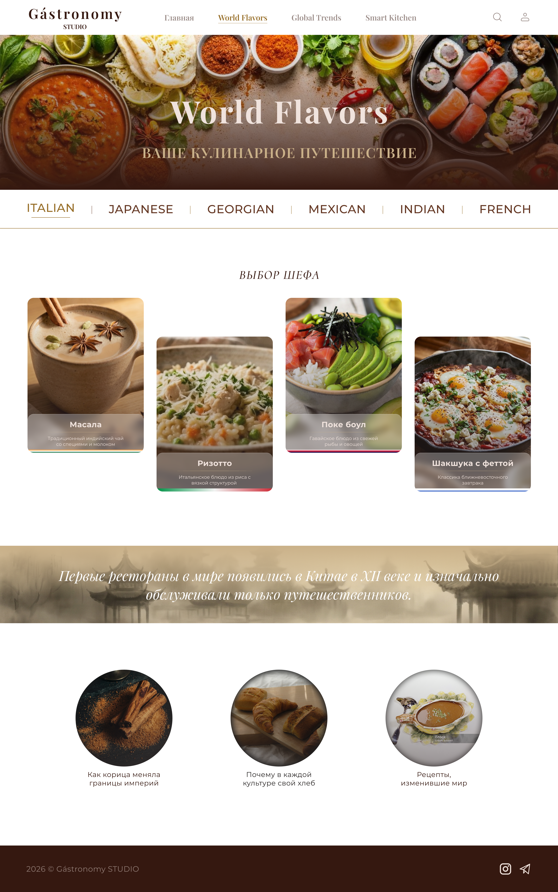
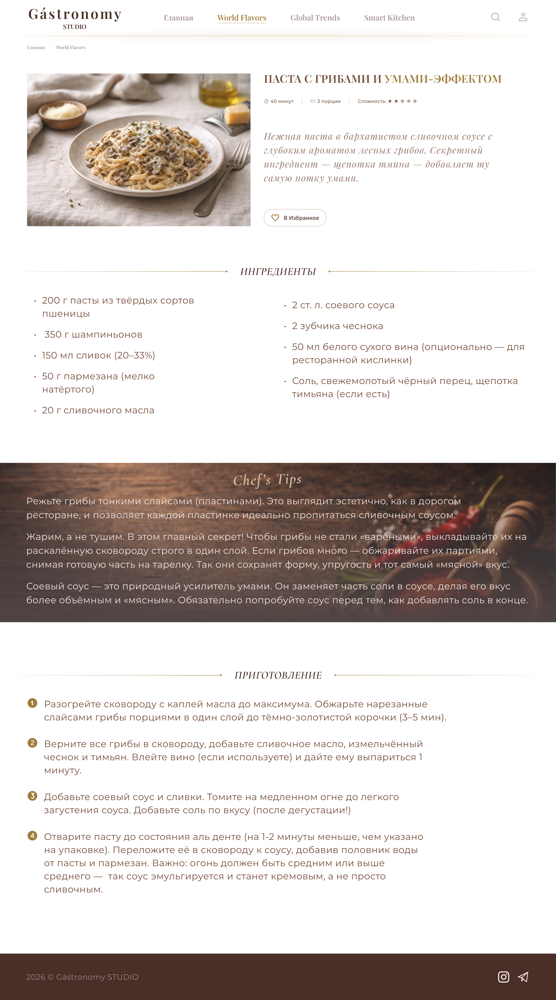
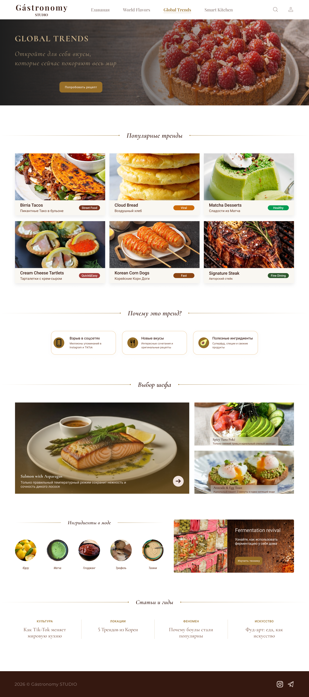
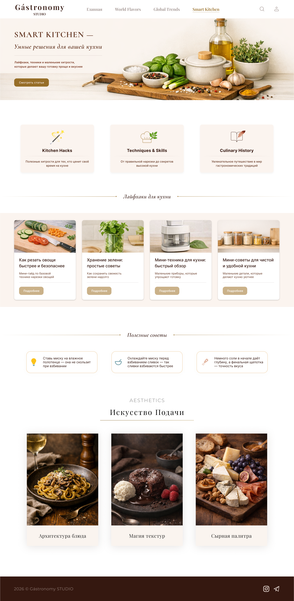
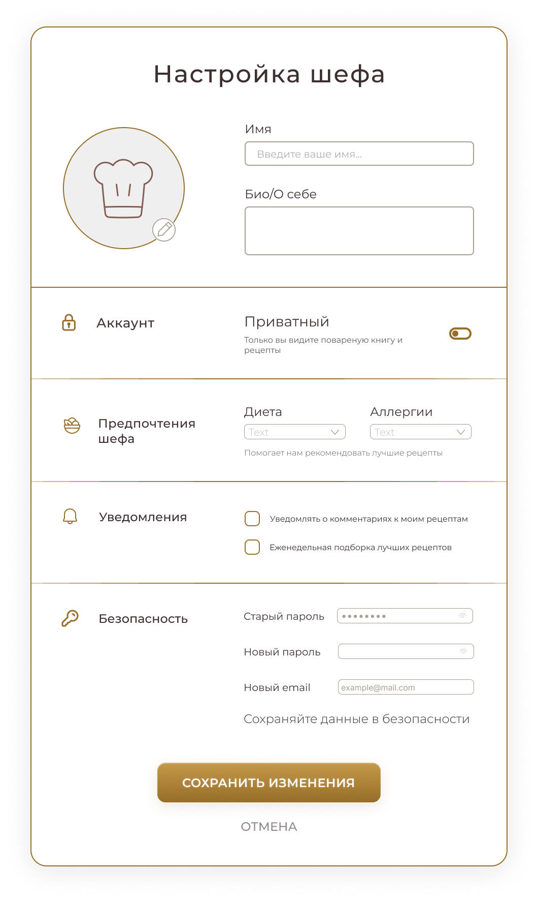
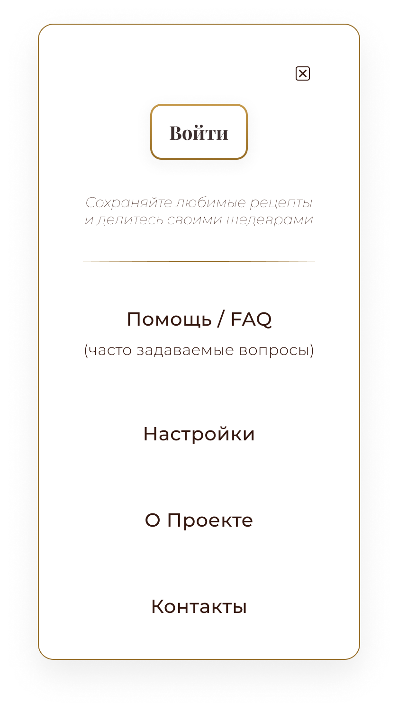
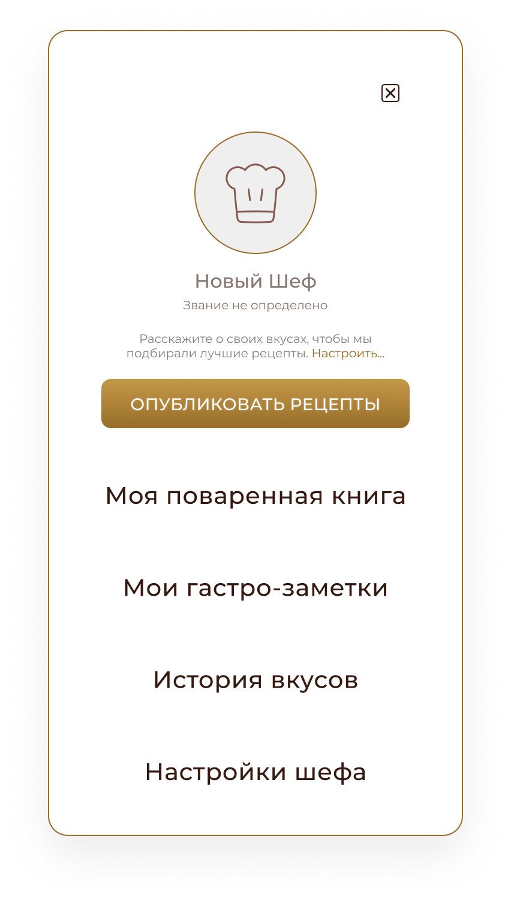
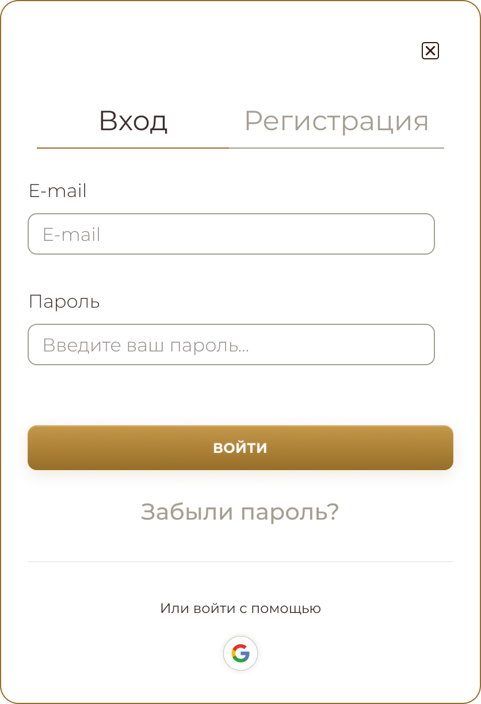
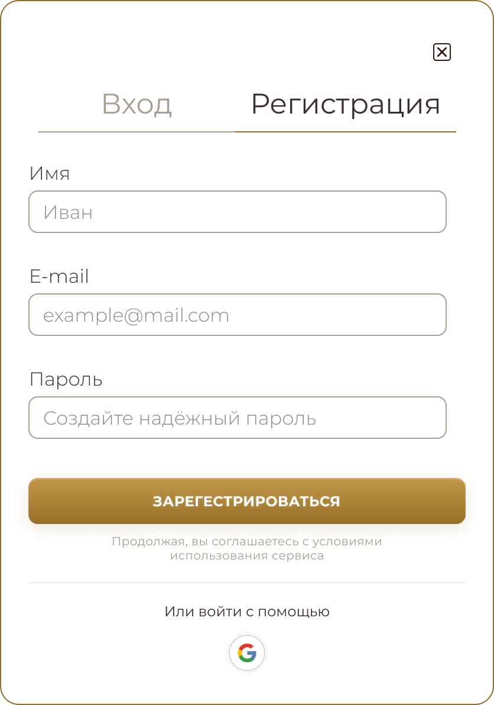

[English](README.md) | [Русский](README.ru.md)

# Gastronomy Studio — UI Kit & Web Screens

Designed a component-based visual system (**UI Kit**) and web screen mockups for a culinary website and digital magazine focused on food, recipes, and gastronomic trends. Organized components by functional groups, configured nested Auto Layout, structured layers cleanly, and prepared a portfolio showcase ready for front-end implementation.

## Project Preview

### UI Kit

### Home & Main Sections

### Profile, Menus & Authentication

## Project Structure

- **UI Kit:** a library of reusable interface elements built with nested Auto Layout and consistent layer naming.
- **Screens & Sections:** key page layouts covering content browsing, recipes, profile settings, and authentication flows.

## Design Approach & Interactivity

- Used nested **Auto Layout** for consistent spacing, alignment, and scalable component structure.
- Established a clear, unified naming system across layers and containers.
- Designed interactive component states and user flows in Figma, including hover effects, dropdown menus, and navigation transitions triggered from the profile button.
- Focused the initial release on desktop layouts and core user scenarios; additional states and mobile views were intentionally scoped out of v1 to accelerate development and launch of the live site.

## Status & Roadmap

- The visual component system and core screen layouts are complete and ready for review.
- Cross-section navigation transitions in the prototype header and several secondary blocks are currently in progress.

